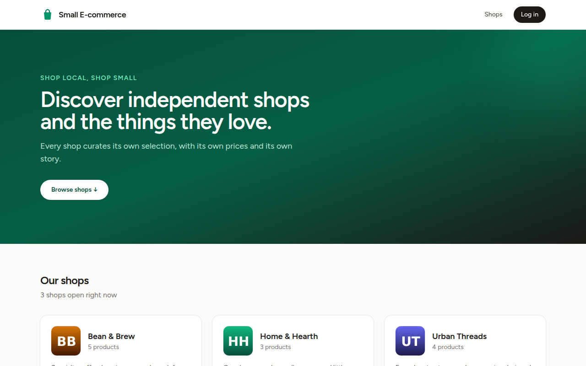
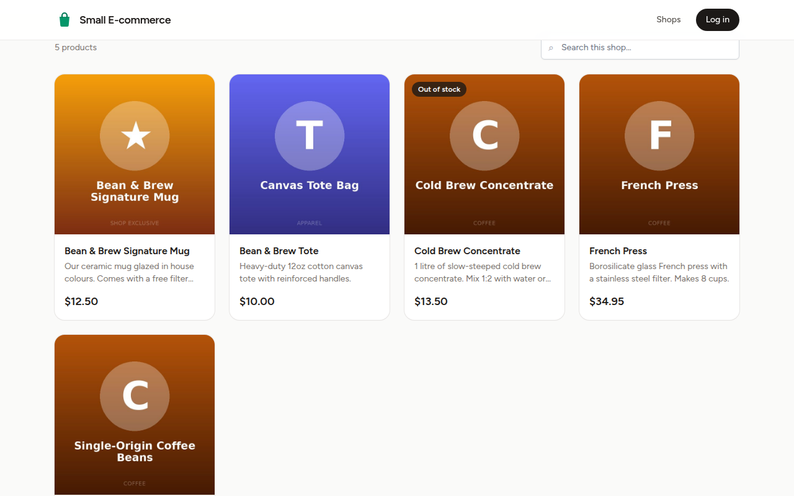
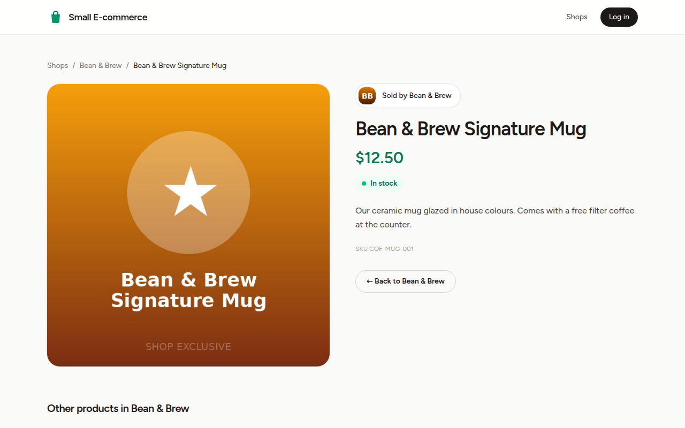
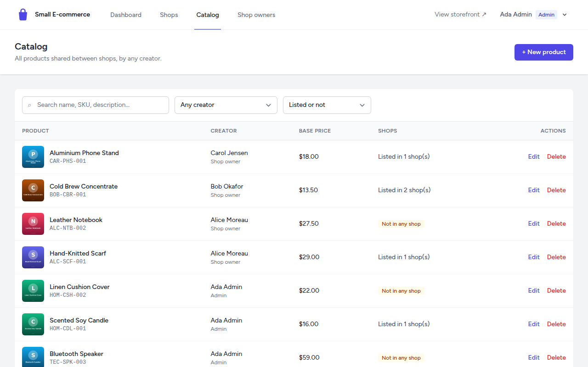
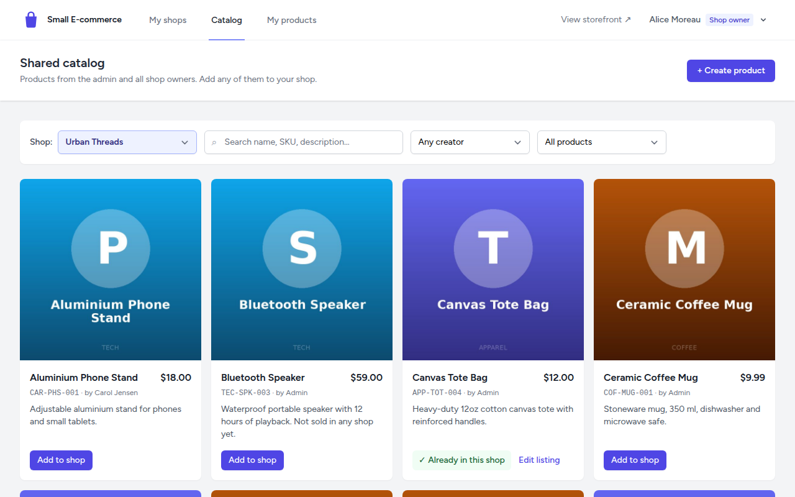
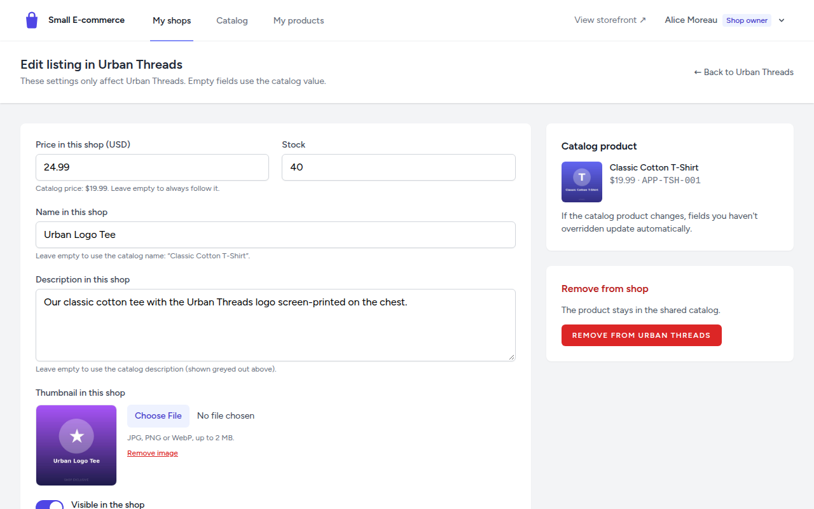

# Small E-commerce Management

A small multi-shop marketplace built with **Laravel 12, Inertia.js, Vue 3 and Tailwind CSS**.

An **admin** manages shops, shop-owner accounts and a **shared product catalog**. **Shop owners** pick products from that catalog (or add their own) and sell them in their shops with **shop-specific prices, names, descriptions, images and stock**. **Customers** browse the public storefront without logging in, and only see products that a shop actually sells.



---

## Contents

- [Features](#features)
- [Tech stack & requirements](#tech-stack--requirements)
- [Installation (MySQL)](#installation-mysql)
- [Quick start (SQLite)](#quick-start-sqlite)
- [Demo accounts](#demo-accounts)
- [How to evaluate (guided tour)](#how-to-evaluate-guided-tour)
- [Data model](#data-model)
- [Design decisions & assumptions](#design-decisions--assumptions)
- [Running the tests](#running-the-tests)
- [Troubleshooting](#troubleshooting)
- [Project structure](#project-structure)

---

## Features

### Admin
- Log in to the admin area (`/admin`) and see dashboard counts.
- **Shops**: create, edit and delete shops, assign each one to a shop owner, upload a logo, activate or deactivate.
- **Shared catalog**: create, edit and delete any product (thumbnail, SKU, base price). Filter by creator (admin / any owner / a specific owner) and listing status (listed / not in any shop). Each row shows "listed in N shops" and who created the product.
- **Shop owners**: create, edit, reset password, activate or deactivate, delete. Deleting an owner who still has shops is blocked.

### Shop owner
- **My shops**: one owner can run several shops.
- **Shared catalog browser**: products from the admin *and* from all other owners, with search and filters. A **shop selector** controls the "✓ Already in this shop" / "Add to shop" state.
- **Add to shop**: a pop-up form with the price (prefilled with the base price), optional name, description and image overrides (the catalog values are shown as hints), and stock.
- **Own products**: create (optionally list it in one of your shops right away), edit and delete. New products join the shared catalog automatically. You can't delete a product that another owner sells.
- **Listings per shop**: search, edit overrides, upload, replace or remove a custom image (removing it falls back to the catalog image), set stock, hide or show, and remove from the shop.
- Products created by others can't be edited, only overridden per shop.

### Customer (public, no login)
- `/`: the list of open shops, with logo, description and number of products.
- `/shops/{shop}`: the shop page with its own products, search and pagination.
- `/shops/{shop}/products/{product}`: the product page with shop-specific values, stock status, a breadcrumb and other products from the same shop.
- Products that aren't assigned to a shop are **never** visible. Inactive shops, inactive owners, hidden listings and deleted products return **404**.

<table>
<tr>
<td></td>
<td></td>
</tr>
<tr>
<td></td>
<td></td>
</tr>
</table>

---

## Tech stack & requirements

| | |
|---|---|
| Backend | Laravel 12 (PHP 8.2+), Laravel Breeze (auth scaffolding) |
| Frontend | Inertia.js 2, Vue 3 (Composition API, `<script setup>`), Tailwind CSS 3, Vite 7 |
| Database | MySQL 8 / MariaDB 10.6+, or SQLite 3 |
| Tests | PHPUnit 11 (feature tests, in-memory SQLite) |

**You need:**

- **PHP 8.2 or newer** with these extensions: `ctype`, `curl`, `dom`, `fileinfo`, `filter`, `hash`, `iconv`, `mbstring`, `openssl`, `pcre`, `pdo`, `session`, `tokenizer`, `xml`, plus
  - `pdo_mysql` for MySQL, and/or
  - `pdo_sqlite` for SQLite. **It is also needed to run the tests.**
  - The `gd` extension is **not** required: seeding copies committed images, and the tests use committed image fixtures.
- **Composer 2**
- **Node.js 20.19+ or 22.12+** (required by Vite 7) and npm
- **MySQL 8** or **MariaDB 10.6+** (or nothing extra for the SQLite quick start)

Check your PHP extensions with `php -m`.

> No internet access is needed at runtime or while seeding. Demo images live in `database/seeders/images/` and are copied into `storage/` by the seeder. Only `composer install` and `npm install` download packages.

---

## Installation (MySQL)

Run each command from the project folder unless noted otherwise.

**1. Clone and install PHP dependencies**

```bash
git clone https://github.com/Moulin-Talukder/small-ecommerce-management.git
cd small-ecommerce-management
composer install
```

**2. Create the environment file and app key**

```bash
cp .env.example .env          # Windows (cmd): copy .env.example .env
php artisan key:generate
```

**3. Create the database.** In a MySQL shell (`mysql -u root -p`), run:

```sql
CREATE DATABASE small_ecommerce CHARACTER SET utf8mb4 COLLATE utf8mb4_unicode_ci;

-- Optional: a dedicated user instead of root
CREATE USER 'ecom'@'localhost' IDENTIFIED BY 'secret';
GRANT ALL PRIVILEGES ON small_ecommerce.* TO 'ecom'@'localhost';
FLUSH PRIVILEGES;
```

**4. Put your database credentials in `.env`.** The defaults are `root` with an empty password:

```dotenv
DB_CONNECTION=mysql
DB_HOST=127.0.0.1
DB_PORT=3306
DB_DATABASE=small_ecommerce
DB_USERNAME=root        # or ecom
DB_PASSWORD=            # or secret
```

**5. Link the storage folder, then create the tables and seed the demo data**

```bash
php artisan storage:link
php artisan migrate --seed
```

**6. Build the frontend**

```bash
npm install
npm run build
```

**7. Start the app**

```bash
php artisan serve
```

Open **http://127.0.0.1:8000** and log in with one of the [demo accounts](#demo-accounts).

> **Developing?** Instead of `npm run build`, keep `npm run dev` running in a second terminal for hot reloading.
>
> **One-command shortcut:** after steps 3 and 4, `composer run setup` runs `composer install`, `key:generate`, `storage:link`, `migrate --seed`, `npm install` and `npm run build` for you. It creates `.env` from `.env.example` if it doesn't exist yet.
>
> **Reset the demo data at any time:** `php artisan migrate:fresh --seed`

---

## Quick start (SQLite)

No database server needed. `.env.sqlite.example` is the same as `.env.example`, but it already points to `database/database.sqlite`.

```bash
git clone https://github.com/Moulin-Talukder/small-ecommerce-management.git
cd small-ecommerce-management
composer install
cp .env.sqlite.example .env           # Windows (cmd): copy .env.sqlite.example .env
php artisan key:generate
php -r "touch('database/database.sqlite');"
php artisan storage:link
php artisan migrate --seed
npm install
npm run build
php artisan serve
```

Open **http://127.0.0.1:8000**.

Shortcut: `cp .env.sqlite.example .env && composer run setup`, then `php artisan serve`.

---

## Demo accounts

Every account uses the password **`password`**. Log in at `/login`.

| Role | Email | What it demonstrates |
|---|---|---|
| Admin | `admin@example.com` | Full back office: shops, shared catalog, shop-owner accounts |
| Shop owner | `alice@example.com` | **Two shops** (Urban Threads, Home & Hearth): shop selector, per-shop overrides (e.g. "Urban Logo Tee" $24.99 vs catalog "Classic Cotton T-Shirt" $19.99), own products (one of them not in any shop) |
| Shop owner | `bob@example.com` | Bean & Brew. His "Cold Brew Concentrate" is also sold by Alice, so **he can't delete it** ("listed in other shops") |
| Shop owner | `carol@example.com` | Owns **Gadget Garage, an inactive shop**: it is hidden from the storefront and its URLs return 404. She *can* delete her own phone stand |
| Shop owner (inactive) | `dan@example.com` | **Deactivated account**: login is refused with a clear message |

**What the seed data contains:** 1 admin, 4 shop owners (1 inactive), 4 shops (1 inactive) and 17 catalog products (1 soft-deleted). There are 17 listings, some with custom prices, names, descriptions or images, one hidden and one out of stock. **Three products are not in any shop**: *Bluetooth Speaker*, *Linen Cushion Cover* and *Leather Notebook*. They must never be visible publicly.

---

## How to evaluate (guided tour)

About 10 minutes. Use a private window for the guest parts.

1. **Storefront as a guest**: open `/`. You see 3 open shops; Gadget Garage is missing because it's inactive.
2. **Shop-specific values**: open **Bean & Brew**. "Bean & Brew Signature Mug" costs **$12.50** with its own image. In the catalog the same product is "Ceramic Coffee Mug" at $9.99. French Press has no overrides and shows the catalog price. Cold Brew is marked *Out of stock*.
3. **404 rules.** Each of these returns a styled 404 page:
   - inactive shop: `/shops/gadget-garage`
   - hidden listing: `/shops/urban-threads/products/canvas-tote-bag` (the same product *is* visible at `/shops/bean-and-brew/products/canvas-tote-bag`)
   - soft-deleted product: `/shops/home-and-hearth/products/vintage-desk-lamp`
   - product not sold by that shop: `/shops/bean-and-brew/products/wool-beanie`
   - **unassigned product**: `/shops/bean-and-brew/products/bluetooth-speaker`. It's also absent from every shop page and from search.
4. **Admin, shared catalog**: log in as `admin@example.com` → **Catalog**. Filter "Not in any shop" to see the 3 unassigned products, or filter by creator. Rows show the creator and "Listed in N shops".
5. **Admin, catalog change vs. shop overrides**: edit *Classic Cotton T-Shirt* and change its base price and description. Then log in as Alice → **My shops → Urban Threads → Manage products**. "Urban Logo Tee" keeps its own $24.99 price and name, and the edit form shows the *new* catalog values as hints.
6. **Owner, shared catalog with the shop selector**: as Alice → **Catalog**. Switch the shop selector between *Home & Hearth* and *Urban Threads* and watch the "✓ Already in this shop" badges change. Choose "Not in Urban Threads" and click **Add to shop** on *Bluetooth Speaker*: the price is prefilled with the base price, and the name, description and image fields show the catalog values. Save, then check that the product appears on `/shops/urban-threads`.
7. **Owner permissions**: as Alice, open `/owner/products/1/edit` (a product created by the admin). You get **403**. Owners can only override other people's products per shop.
8. **Delete block**: log in as `bob@example.com` → **My products** → delete *Cold Brew Concentrate*. You get the red toast *"This product is listed in other shops"*.
9. **Account management**: as admin → **Shop owners**. Deactivate Bob, then try to log in as Bob: it's refused, and his shop disappears from the storefront. Activate him again afterwards. Deleting Alice is blocked because she still owns shops.



---

## Data model

```
users ─┬─< shops ─────────< shop_products >───────── products
       │   (owner_id)        (one row per shop      (shared catalog,
       │                      that sells a product)  soft deletes)
       └──────────────────────────────────────────< products.created_by
```

| Table | Columns |
|---|---|
| `users` | `id, name, email (unique), password, role enum('admin','shop_owner'), is_active, timestamps` |
| `shops` | `id, owner_id → users (restrict on delete), name, slug (unique), description, logo, is_active, timestamps` |
| `products` | `id, name, slug (unique, incl. trashed), description, base_price decimal(10,2), thumbnail, sku (unique, nullable), created_by → users (null on delete), timestamps, deleted_at` |
| `shop_products` | `id, shop_id → shops (cascade), product_id → products (cascade), price decimal(10,2) NULL, custom_name NULL, custom_description NULL, custom_thumbnail NULL, stock, is_active, timestamps, UNIQUE(shop_id, product_id)` |

### Shared catalog + per-shop overrides

`products` holds the catalog values. `shop_products` connects a product to a shop. Every override column there is **nullable**: an empty value means "use the catalog value". The fallback logic lives in one place, the `ShopProduct::display_*` accessors (`display_name`, `display_description`, `display_price`, `display_thumbnail_url`). Because of that, **editing a catalog product never touches a shop's overrides**, and fields a shop hasn't overridden update automatically.

### Public visibility rule (single source of truth)

A product is visible at `/shops/{shop}/products/{product}` only if **all** of these hold:

1. the shop is active **and** its owner's account is active;
2. a `shop_products` row exists for this shop and this product, **and** it is active;
3. the catalog product isn't soft-deleted.

The rule is implemented once as Eloquent scopes, `Shop::publiclyVisible()` and `ShopProduct::publiclyVisible()`. The storefront routes take plain slugs and resolve them **only** through these scopes, so anything else is a 404. No public route takes a product without a shop.

---

## Design decisions & assumptions

- **Nullable per-shop price.** `shop_products.price = NULL` means "follow the catalog base price". The *Add to shop* form prefills the base price; clearing the field makes the listing follow future catalog price changes.
- **Several shops per owner.** The admin can assign more than one shop to an owner. Listing management is per shop (`/owner/shops/{shop}/listings`), and the catalog has a shop selector.
- **Soft deletes for catalog products.** A deleted product disappears from every shop but stays in the database. Slugs stay unique across deleted rows (a new "T-Shirt" becomes `t-shirt-2`), and so do SKUs.
- **Deleting products:**
  - the admin can always delete (soft delete);
  - an owner can delete their own product only if no *other* owner's shop lists it;
  - an owner can never edit products created by others, only override them per shop.
- **Deleting accounts and shops:**
  - an owner who still owns shops can't be deleted;
  - products created by a deleted owner stay in the catalog;
  - deleting a shop removes its listings and image files.
- **No public registration, no self-deletion.** The admin creates and removes accounts. The profile page lets users change their name, email and password only.
- **Deactivation.** Inactive users can't log in and are logged out on their next request. Their shops are hidden from the storefront.
- **Images** are stored on the `public` disk (`storage/app/public`, served via `storage:link`). They must be jpg, png or webp, at most 2 MB. Old files are deleted when an image is replaced or removed. URLs are root-relative (`/storage/...`), so images work whatever host or port you serve the app on.
- **Out of scope:** cart, checkout, orders, payments, multiple currencies (prices are shown in USD) and e-mail delivery (password-reset mails go to the log, `MAIL_MAILER=log`).
- **Portability:** there is no MySQL-only SQL. The app and the full test suite run on both MySQL and SQLite.

---

## Running the tests

```bash
php artisan test
```

The feature tests use an in-memory SQLite database (this needs `pdo_sqlite`). They don't need a built frontend or the GD extension, and they never touch your `.env` database. Areas covered:

- the visibility rules and every 404 case;
- override fallbacks, including "catalog edits keep shop overrides";
- role and permission checks: a sweep that hits every admin and owner route as the wrong user;
- shop, catalog, account and listing management;
- image upload, replace and delete;
- duplicate listings;
- the owner delete block;
- unique slugs with soft deletes;
- the seeders;
- an N+1 guard (query counts of the main pages must not grow with the data).

To run the same suite against MySQL instead, create an empty `small_ecommerce_test` database first. **The tests wipe it.**

```bash
DB_CONNECTION=mysql DB_DATABASE=small_ecommerce_test php artisan test
```

---

## Troubleshooting

| Problem | Fix |
|---|---|
| **`Vite manifest not found at public/build/manifest.json`** | Run `npm install && npm run build`, or keep `npm run dev` running. |
| **Images don't show** (broken thumbnails and logos) | Run `php artisan storage:link`. If `public/storage` exists but is a plain folder (e.g. it was copied), delete it and run the command again. If the images themselves are missing, reseed: `php artisan migrate:fresh --seed`. |
| **`SQLSTATE[HY000] [2002] Connection refused`** | MySQL isn't running, or `DB_HOST`/`DB_PORT` are wrong. Start MySQL, or try `DB_HOST=localhost`. Then run `php artisan config:clear`. |
| **`Access denied for user`** / **`Unknown database`** | Check `DB_USERNAME`/`DB_PASSWORD` and create the database (step 3). On Ubuntu, MySQL `root` often uses socket authentication: create a dedicated user as shown in step 3. |
| **`could not find driver`** | Install or enable `pdo_mysql` (or `pdo_sqlite`) for the PHP CLI, then check with `php -m`. |
| **`Permission denied` on `storage/` or `bootstrap/cache`** | The web server user must be able to write there: `chmod -R ug+rwx storage bootstrap/cache` (and `chown` them to your web-server user if you're not using `php artisan serve`). |
| **`No application encryption key has been specified`** | Run `php artisan key:generate`. |
| **Changes to `.env` are ignored** | Run `php artisan config:clear`. |
| **Login says the account is deactivated** | Expected for `dan@example.com`. For other users, an admin can re-activate them under **Shop owners**. |
| **Seeder says "Demo data is already seeded"** | Run `php artisan migrate:fresh --seed` to reset everything. |
| **Port 8000 is in use** | Run `php artisan serve --port=8080`. Images still work, because their URLs are root-relative. |

---

## Project structure

```
app/
  Enums/Role.php                         admin | shop_owner
  Http/Controllers/Admin/                dashboard, shops, catalog, shop owners
  Http/Controllers/Owner/                dashboard, catalog browser, own products, listings
  Http/Controllers/Storefront/           public shop list, shop page, product page
  Http/Middleware/                       EnsureUserHasRole (role:…), EnsureUserIsActive
  Http/Presenters/StorefrontListing.php  public payload (display values only)
  Http/Requests/                         FormRequest validation (Admin/, Owner/, Product/)
  Models/                                User, Shop, Product, ShopProduct (+ Concerns/HasUniqueSlug)
  Policies/                              User, Shop, Product, ShopProduct policies
  Services/                              CatalogProductService, ListingService
  Support/ImageUploader.php              public-disk uploads + cleanup
database/
  migrations/  factories/  seeders/      seeders/images/ = committed demo images
resources/js/
  Layouts/                               AuthenticatedLayout (back office), StorefrontLayout
  Pages/Admin|Owner|Storefront|Auth/     Inertia pages, plus Error.vue (403/404)
  Components/                            shared UI (ConfirmDialog, ImageInput, Pagination, …)
tests/Feature/                           feature tests (see "Running the tests")
```
